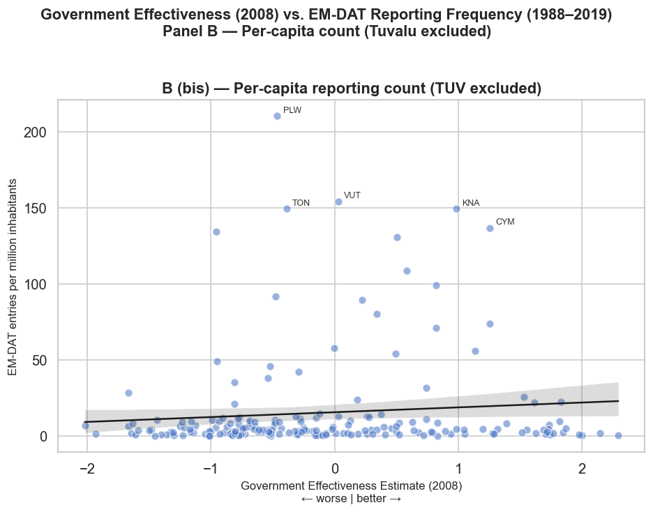
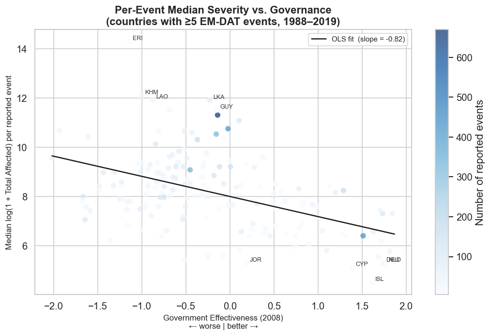

# Multinational networks and natural disasters

Code for my master's thesis in Business Engineering (Data Analytics) at Ghent University, 2025-2026, supervised by Prof. dr. Bruno Merlevede.

**Question.** How does the presence of European multinational affiliates relate to natural disaster exposure in host countries? And do institutional quality and position in global value chains condition that relationship?

📄 [Read the full thesis (PDF)](docs/thesis.pdf) · 🛠️ [Detailed pipeline documentation](docs/pipeline.md)

---

## Data

I built a dyadic panel (home country × host country × industry × year) by merging five public sources:

| Source | What it provides |
|---|---|
| Eurostat FATS (outward) | Number of foreign affiliates and their employees, by home country, host country and industry |
| EM-DAT (CRED, UCLouvain) | Natural disaster events, types and people affected |
| World Bank WDI and WGI | GDP, population, land area, Government Effectiveness |
| OECD TiVA | Position of each industry in global value chains (upstream vs downstream) |
| CEPII GeoDist | Distance, common language, colonial ties, contiguity |

**Coverage:** 29 European home countries, up to 185 host countries, 2008-2019. The main estimation sample has 104,453 observations.

Raw data is not included in this repository (EM-DAT does not allow redistribution). See [`data/README.md`](data/README.md) for where to download each file and where to put it.

## Methods

| Research question | Design | Estimators |
|---|---|---|
| **RQ1.** Is a host country's historical exposure to natural disasters associated with the level of European affiliate presence, and does government effectiveness moderate that association? | Cross-section of 2008-2019 averages per country pair | Gravity model estimated by OLS (HC3 errors); robustness on employment and on the extensive margin (LPM, logit) |
| **RQ2.** How does affiliate presence evolve in the five years after a sudden disaster, and does that path differ with the host's exposure history? | Local projections, horizons h = 0 to 5 | PPML with dyad and year fixed effects, dyad-clustered errors; log-OLS, restricted shock cohort and seasonal placebo as robustness |
| **RQ3.** Does a host country-sector's position in the global value chain moderate the disaster response, and is that moderation conditioned by exposure history? | Local projections with a triple interaction (disaster × GVC position × exposure history), 56 hosts with TiVA data | PPML; log-OLS, 2008-2016 shock cohort and median split as robustness |

The design is associational throughout: no causal claim is made.

## Key findings

- **RQ1.** Host countries with a longer record of reported disasters show a *greater* presence of European affiliates, and institutional quality attenuates this association without reversing it. The level association holds across every outcome, margin and functional form tested; the moderation by governance is weaker.
- **RQ2.** No rebound: the estimated path is negative at every horizon within five years, so the "creative destruction" pattern fails on its sign before significance is even considered. Whether the path differs with exposure history cannot be determined.
- **RQ3.** No reliable answer. One significant coefficient appears among more than a hundred estimates, and it is reproduced under neither an alternative estimator nor an alternative outcome.

The main contribution is about **measurement**. Reported disaster frequency in EM-DAT moves with the same governance characteristics that this literature uses as moderators, so a cross-country design like this one cannot separate physical hazard from reporting capacity. The two figures below, built for the thesis, document this directly.

<p align="center">
  
  
</p>

Better-governed countries tend to report *more* events per capita, but each reported event is *less* severe on average. A raw event count therefore partly measures reporting capacity, not only exposure.

## Repository structure

```
├── scripts/                  Data pipeline (run in numerical order)
│   ├── 01_clean_fats.py              Eurostat FATS download (API) and cleaning
│   ├── 02_clean_emdat.py             EM-DAT cleaning and historical exposure measures
│   ├── 03_clean_wdi_wgi.py           World Bank macro and governance controls
│   ├── 04_clean_tiva.py              OECD TiVA, GVC position index
│   ├── 05_clean_cepii.py             CEPII gravity variables
│   ├── 06_standardise_countries.py   ISO-3 harmonisation across sources
│   ├── 07_merge.py                   Builds the full panel
│   ├── 08_create_estimation_sample.py   Intensive-margin sample
│   ├── 09_create_extensive_sample.py    Extensive-margin sample (with zeros)
│   └── 10_clean_geo_controls.py      Land area and landlocked status
├── notebooks/
│   ├── 01_rq1_location_cross_section.ipynb
│   ├── 02_rq2_creative_destruction_event_study.ipynb
│   ├── 03_rq3_gvc_position_and_exit.ipynb
│   ├── 04_emdat_reporting_bias.ipynb
│   ├── 05_exploratory_data_analysis.ipynb
│   └── 06_validate_fats_world_suppression.ipynb
├── outputs/tables/           Regression tables (CSV and HTML)
├── figures/                  Figures used in the thesis
├── docs/                     Thesis PDF and pipeline documentation
└── data/                     Empty: see data/README.md
```

The notebooks were written while the research questions were still framed as hypotheses, so they refer to H1, H2 and H3. These correspond to RQ1, RQ2 and RQ3 in the thesis. Notebook outputs are kept so the results can be read without re-running anything. The notebooks also record the exploration as it happened, so some of their commentary is more optimistic than the final conclusions. Where they differ, the thesis is the reference.

## Reproducing the results

```bash
conda env create -f environment.yml
conda activate mne-disasters

# 1. Download the raw files listed in data/README.md into data/Bronze/
# 2. Run the pipeline (01 downloads FATS directly from the Eurostat API)
python scripts/01_clean_fats.py
python scripts/02_clean_emdat.py
python scripts/03_clean_wdi_wgi.py
python scripts/04_clean_tiva.py
python scripts/05_clean_cepii.py
python scripts/10_clean_geo_controls.py
python scripts/06_standardise_countries.py
python scripts/07_merge.py
python scripts/08_create_estimation_sample.py
python scripts/09_create_extensive_sample.py
# 3. Open the notebooks
```

## A note on tools

I designed the research questions, the data architecture and the empirical strategy, and made the methodological decisions. Much of the code was written with the help of AI coding assistants (Claude), which I directed and reviewed. This use is also declared in the thesis foreword.

## License

The code is released under the MIT License. The thesis text in `docs/` remains © Nathan Szelagowski. Each data source keeps its own terms of use.
